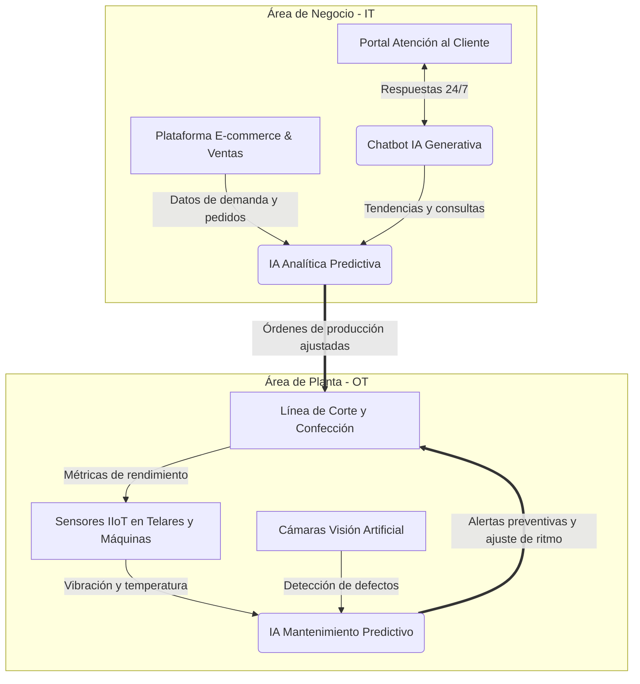

# Estructura IT/OT y Flujo de IA en Textil Innova S.A.

El siguiente diagrama representa cómo se conectan los sistemas de negocio (IT) con los procesos de fábrica (OT), mostrando el papel de la Inteligencia Artificial como eje central para optimizar la producción y la atención al cliente:

